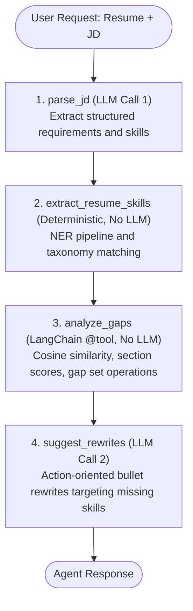

# AI Resume Analyzer

**Live App:** [https://ai-resume-analyzer-three-eosin.vercel.app/](https://ai-resume-analyzer-three-eosin.vercel.app/)

I built this full-stack resume analysis application to help job seekers compare their resumes against specific job descriptions. It identifies skill gaps, scores fit across key dimensions, and provides concise improvement suggestions.

## Features

- **Smart Comparison**: Compares your resume against any job description using Sentence Transformers semantic similarity.
- **Skill Gap Detection**: Identifies matched, missing, and transferable skills via BERT NER and taxonomy matching.
- **Detailed Scoring**: Section-level scoring for technical skills, soft skills, experience, education, keywords, and overall fit.
- **Stateful LangGraph AI Agent**: Multi-step graph that reads a resume and a JD, finds skill gaps, and suggests concrete resume rewrites.
- **Actionable Feedback**: Deterministic feedback suggestions and tailored AI bullet rewrites.
- **History & Stats**: Tracks your past analyses and shows aggregate stats in SQLite.
- **Modern UI**: A responsive React interface with dark/light theme support and lazy-loaded panels for optimized performance.

## Tech Stack

### Backend

- FastAPI
- LangGraph & LangChain
- Google Gemini (ChatGoogleGenerativeAI)
- Sentence Transformers (all-MiniLM-L6-v2)
- Hugging Face Transformers (bert-base-NER, flan-t5-base)
- SQLAlchemy & SQLite
- PyTorch
- pdfminer.six

### Frontend

- React & Vite
- Recharts
- Axios
- Lucide React

## LangGraph Agent Architecture

The application includes a stateful LangGraph agent that performs deep resume-to-job analysis, gap detection, and targeted bullet rewrites.

### Workflow Diagram



### Graph Nodes and Edge Flow

The workflow is compiled as a LangGraph `StateGraph` with a linear edge sequence:
`parse_jd -> extract_resume_skills -> analyze_gaps -> suggest_rewrites`

1. **`parse_jd` (LLM Call 1)**:
   - Uses `ChatGoogleGenerativeAI` with Google Gemini.
   - Extracts structured requirements categorized by technical, soft skill, experience, and education.
   - Outputs flat skill lists and structured requirements.
   - Strictly validates JSON outputs using Pydantic models with graceful fallbacks.

2. **`extract_resume_skills` (No LLM Call)**:
   - Reuses existing `extract_skills` logic from `analyzer.py`.
   - Uses `bert-base-NER` token classification combined with regex taxonomy matching against `data/skill_taxonomy.json`.

3. **`analyze_gaps` (No LLM Call, LangChain Tool)**:
   - Wraps the existing similarity and scoring pipeline as a LangChain `@tool` (`resume_jd_scorer`).
   - Reuses `compute_similarity`, `analyze_gap`, and `compute_section_scores`.
   - Produces matched skills, missing skills, transferable skills, cosine similarity, and 6-dimension section scores.

4. **`suggest_rewrites` (LLM Call 2)**:
   - Uses `ChatGoogleGenerativeAI` to generate resume bullet improvements specifically targeting detected skill gaps.
   - Employs action verbs and measurable business impact.
   - Maximum 2 LLM calls per request across the entire graph.

### State Fields (`AgentState`)

- `resume_text` (str): Raw resume text provided by the candidate.
- `jd_text` (str): Raw job description text.
- `jd_requirements` (dict): Structured requirements and parsed skills from `parse_jd`.
- `resume_skills` (list of str): Canonical skills extracted from the candidate resume.
- `jd_skills` (list of str): Skills identified from the job description.
- `gaps` (dict): Gap analysis data (matched, missing, transferable, section scores).
- `suggestions` (dict): Concrete resume bullet rewrites and general advice.
- `node_errors` (dict): Per-node error tracking for graceful degradation.

### Endpoint and Configuration

- **Route**: `POST /api/agent/analyze` (also aliased at `POST /agent/analyze`)
- **Payload**: `{"resume_text": "...", "jd_text": "..."}`
- **Required Environment Variables**:
  - `GOOGLE_API_KEY`: API key from Google AI Studio.
  - `GEMINI_MODEL`: Model identifier (defaults to `gemini-3.8-flash`).
- **Error Handling**:
  - `503`: Missing or unconfigured `GOOGLE_API_KEY`.
  - `400`: Empty inputs.
  - `429`: Google AI Studio rate limit or quota exceeded.
  - `504`: Request timeout.

## Project Structure

```text
backend/
  main.py              FastAPI entrypoint and CORS configuration
  analyzer.py          Semantic similarity and gap calculation
  models.py            ModelManager for embedding and NER models
  schemas.py           Pydantic schemas
  parser.py            PDF extraction and resume segmentation
  feedback.py          Deterministic fallback and legacy feedback
  database.py          SQLite models and session management
  agent/
    graph.py           StateGraph definition and node functions
    router.py          FastAPI router for /api/agent/analyze
  rag/
    loaders.py         File loading (txt, md, pdf, docx) and chunking
    store.py           FAISS index with save/load
    qa.py              Ingest, retrieval and answers with citations
    router.py          FastAPI router for /rag/ask
    sample_docs/       Example resume and two JDs to try it on
frontend/
  src/
    App.jsx            Main layout and tab orchestration
    api.js             Axios client with VITE_API_BASE_URL resolution
    components/
      AgentPanel.jsx   AI Agent suggestions and rewrite cards
      AskPanel.jsx     Ask Your Resume tab (rag questions)
      UploadPanel.jsx  Resume upload and input panel
      ScoreGauge.jsx   Circular fit gauge
      RadarChart.jsx   6-dimension section chart
      SkillBadges.jsx  Matched and missing chips
      FeedbackPanel.jsx General feedback list
      StatsPanel.jsx   Aggregate metrics
      HistoryTable.jsx Historical runs
```

## Backend Setup

```bash
cd backend
python -m venv .venv
.venv\Scripts\activate
pip install -r requirements.txt
python -m uvicorn main:app --host 127.0.0.1 --port 8000
```

The API will run at:

```text
http://127.0.0.1:8000
```

## Frontend Setup

```bash
cd frontend
npm install
npm run dev
```

The frontend will run at:

```text
http://127.0.0.1:5173
```

## Ask Questions Over Your Resume and JDs (RAG)

A small retrieval setup in `backend/rag/`. You index your resume and some job descriptions, then ask things like "which of my projects match this JD". It splits the files into overlapping chunks, embeds them with the same `all-MiniLM-L6-v2` model the analyzer uses, and keeps them in a local FAISS index.

If `OPENROUTER_API_KEY` is set, the top chunks are sent to a GPT model on OpenRouter (through the `openai` client) and you get a written answer with `[file #chunk]` citations. Without a key it still works offline and just prints the closest passages with their source and score.

Setup (from `backend/`, same venv as the backend):

```bash
pip install -r requirements.txt
```

Env vars (put them in `.env`, see `.env.example`):

- `OPENROUTER_API_KEY`: optional. Leave it unset for the offline mode.
- `RAG_MODEL`: OpenRouter model id, default `openai/gpt-4o-mini`.
- `RAG_BASE_URL`: default `https://openrouter.ai/api/v1`.
- `RAG_INDEX_DIR`: where the index is saved, default `backend/rag_index/` (gitignored).
- `RAG_EMBED_MODEL`: embedding model, default `all-MiniLM-L6-v2`.

Index files or folders (`.txt`, `.md`, `.pdf`, `.docx`), then ask:

```bash
cd backend
python -m rag ingest rag/sample_docs
python -m rag ingest path/to/resume.pdf path/to/jds/
python -m rag ask "Which of my projects match the backend developer requirements?"
python -m rag ask "What skills am I missing for the data analyst role?" -k 6
```

Running `ingest` again rebuilds the index from the paths you give it. `--chunk-size` and `--overlap` can be changed on ingest (defaults 500 and 100 characters).

### In the app

The frontend has an "Ask Your Resume" tab. Paste resume and JD text or upload up to 5 files (`.txt`, `.md`, `.pdf`, `.docx`), type a question and it shows the answer with its sources. Without a key on the server it says so and shows the top passages.

It calls `POST /rag/ask` (also at `/api/rag/ask`) with multipart form data:

- `question` (required), `k` (optional, default 4)
- `resume_text`, `jd_text` (optional pasted text)
- `files` (optional, repeat for more than one file)

If you send text or files, a temporary index is built in memory just for that request and nothing is saved. If you send nothing, it uses the index from `python -m rag ingest`, or the sample docs if there is no saved index.

```bash
curl -X POST http://127.0.0.1:8000/rag/ask \
  -F "question=Which of my projects match this JD?" \
  -F "jd_text=Needs Python, FastAPI and Docker" \
  -F "files=@resume.pdf"
```

Tests (they use a fake embedder, so no model download or API key is needed):

```bash
cd backend
pytest tests/test_rag.py
```

One test runs the real embedding model on the sample docs and is skipped if the model is not in the local cache yet.

## Production Build

```bash
cd frontend
npm run build
```

Build output is generated in:

```text
frontend/dist
```

## Verification

Run backend feedback generation:

```bash
python scripts/test_feedback.py
```

With the backend running on port `8000`, test the analyze endpoint:

```bash
python scripts/test_analyze.py
```

Run the backend agent test suite (with LLM mocked and edge cases tested):

```bash
pytest backend/tests/test_agent.py
```

Run the RAG tests:

```bash
pytest backend/tests/test_rag.py
```

Run the frontend production build:

```bash
cd frontend
npm run build
```

## Deployment Notes

The frontend can be deployed as a Vite static application on Vercel. The FastAPI backend is deployed on Hugging Face Spaces via Docker.
